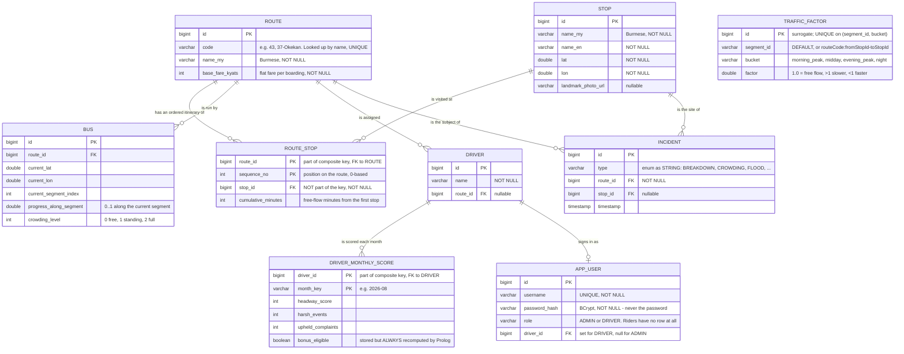

# Database — ER diagram

Nine tables in MySQL, created and kept up to date by Hibernate from the JPA entities
(`ddl-auto=update`) and seeded from `data.sql` on startup (`INSERT IGNORE`, so the network
loads on first run and admin edits survive restarts). Schema changes come from the entities,
and the baseline data comes from `data.sql`.

The ninth is `app_user`, added with sign-in: it holds the account, its role, and for a driver
the `driver_id` that makes "my shift" mean one person's shift.

Everything below was read off the entity classes rather than written from memory.

---

## The diagram

`TRAFFIC_FACTOR` stands alone: it is keyed by a *string* segment id rather than by a foreign
key, so it can describe a segment that has no row of its own and fall back to `DEFAULT`.

---

## Design decisions worth defending

### `route_stop` is keyed by (route, **sequence**) — not (route, stop)

The obvious key is (route, stop), and that is what this started as. It is wrong. A route can
legitimately visit the same stop twice: loop services return to their terminus, and some
routes double back through a junction. In the real YBS data **23 route/stop pairs repeat**,
and a (route, stop) key rejected them outright.

Keying by position fixes it, because a position is genuinely unique on a route. `stop_id`
becomes an ordinary non-key foreign key.

### `bus` carries no dwell column

`Bus.dwellSecondsRemaining` is `@Transient` — live simulation state, not something the seed
data describes. Persisting it would mean writing a value every tick that nobody reads on the
next startup.

### `driver_monthly_score.bonus_eligible` is stored but never trusted

The column exists and `data.sql` seeds it `false` for **every** driver. The ops dashboard
recomputes it per request by asking Prolog `bonus_eligible(dN, 'YYYY-MM')`. Seeding it false
is deliberate: if the rule engine ever died, every badge would read "not eligible" — a
visible failure rather than stale data quietly passing as a correct answer.

### `id` values are explicit in the seed

Every table uses `GenerationType.IDENTITY`, but `data.sql` supplies ids anyway, because
`route_stop`, `bus`, `driver_monthly_score` and `incident` all reference them. MySQL accepts
explicit ids into an identity column, which is what makes the seed reproducible.

---

## Constraint hygiene

Two integrity gaps were closed when the app moved to a persistent database:

- **`route.code` is unique.** It is used as a lookup key — `NetworkService.routeByCode` and
  the URL `/api/routes/{code}` — so a duplicate code would silently shadow one of the routes.
  It is declared `unique = true` on the entity.
- **`traffic_factor` is unique on `(segment_id, bucket)`**. A surrogate `id` alone would let a
  hand-written `data.sql` insert two priors for the same segment/bucket, and
  `findBySegmentIdAndBucket` would silently use whichever came first. There is now a
  `UNIQUE` constraint (`uk_traffic_segment_bucket`).
- **`incident.route_id` is now a real `@ManyToOne` FK** to `route` (it was a plain `bigint`).
  Incidents on nonexistent routes are now rejected by the database. `stop_id` remains nullable
  because a corridor-level incident may not map to a specific stop.

With a persistent MySQL database behind the app these are constraints, not aspirations: they
are enforced by the schema, not just by whichever code happened to write the data carefully.

---

## Where the schema lives

| Thing | Where |
|---|---|
| Table definitions | the JPA entities, one per feature package |
| Seed data | `backend/src/main/resources/data.sql` |
| Schema creation | Hibernate `ddl-auto=update` against MySQL (`ybs_db`) |
| Editing data | `/admin.html`; edits persist, and `/admin.html` can export the current state as `data.sql` |

There is no migration tool and no schema file to edit by hand. Change an entity and the table
is altered on the next run against MySQL.
