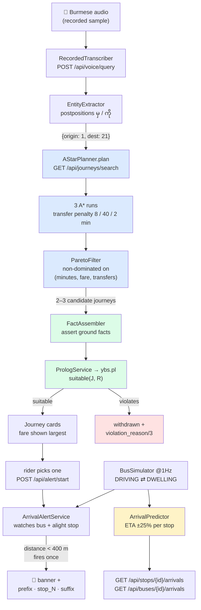
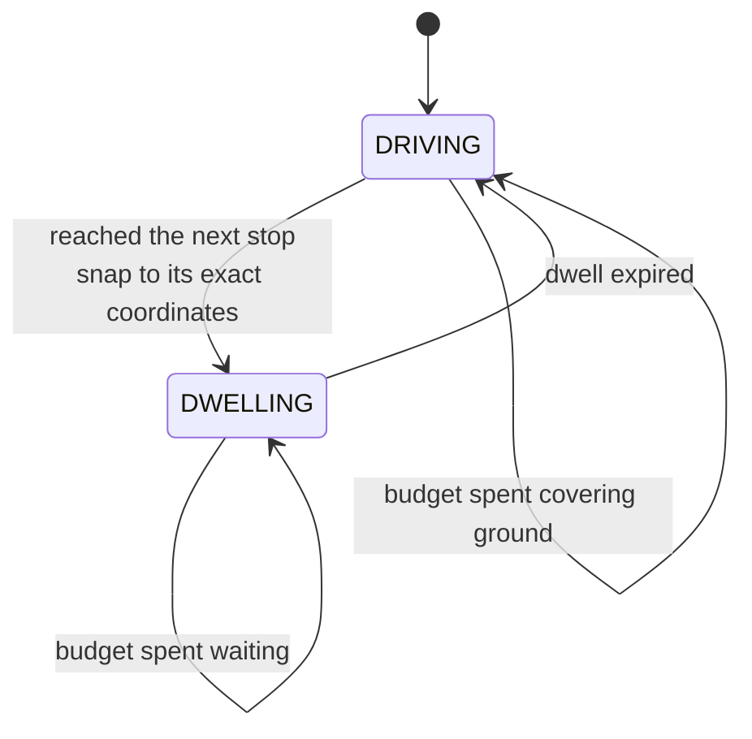

# YBS demo — system workflow

How a request actually moves through this system, from a spoken Burmese sentence to a bell
ringing 400 m before the rider's stop. Every box names the real class and endpoint, so this
doubles as a map of the codebase.

The system has **one rule worth stating up front**: search and reasoning are kept apart.
A\* never knows who the rider is. It produces candidate journeys purely from time, fare and
transfers, and the Prolog rule base then rules them in or out. That separation is what makes
the demo's central move possible — flipping a profile toggle re-filters *the same* search
results, so the change visibly comes from the reasoning layer rather than from re-running the
search with different parameters.

---

## The whole path



Blue is heuristic search, green is symbolic reasoning, amber is reasoning under uncertainty.

---

## Stage by stage

### 1 — Voice → intent (`voice/`)

**AI topic: NLP / speech.**

`POST /api/voice/query?sample=sample2` picks a transcriber behind the project's only
interface, `VoiceTranscriber`:

| Mode | Implementation | Behaviour |
|---|---|---|
| `recorded` (default) | `RecordedTranscriber` | Looks the transcript up from a fixed map, with an artificial 800 ms delay. Works with the network unplugged. |
| `whisper` | `WhisperHttpTranscriber` | POSTs the audio to a self-hosted Whisper endpoint, and **falls back to `recorded` if it fails** so the demo cannot hard-fail here. |

`EntityExtractor` then does string matching, not language modelling — and says so. It scans
stop names **longest first** (so a name containing another doesn't lose to it) and keys off
two Burmese postpositions:

- `မှ` — *from* → origin
- `ကို` — *to* → destination

```
"အင်းစိန်ဈေးမှ ဗိုလ်တထောင်ဘုရားကို သွားချင်တယ်"
   └─ အင်းစိန်ဈေး + မှ  → origin = stop 1
                └─ ဗိုလ်တထောင်ဘုရား + ကို → dest = stop 21
```

Response carries `understood = (originStopId != null && destStopId != null)`. The frontend
renders the parse as chips so the NLP step is **visible**, not taken on trust.

### 2 — Search (`planning/`)

**AI topic: heuristic search.**

The graph node is a **(stop, route)** pair, not a stop. `routeCode == null` means "standing
at this stop, not on a bus" — and that is what makes a transfer explicit and therefore
chargeable, because you cannot change route without passing through the null-route node.

| Edge | From → To | Cost |
|---|---|---|
| ride | `(stop_i, R)` → `(stop_i+1, R)` | traffic-scaled travel **+ dwell at the arriving stop** |
| board | `(stop, null)` → `(stop, R)` | fare, plus a transfer penalty unless it's the first boarding |
| alight | `(stop, R)` → `(stop, null)` | free |
| walk | `(stopA, null)` → `(stopB, null)` | distance ÷ 4.5 km/h, within 400 m |

**Heuristic:** `haversine(stop, goal) ÷ heuristicSpeedKmh`. Admissible because a straight
line is a lower bound on remaining distance and `heuristicSpeedKmh` is an upper bound on
achievable speed — and that bound is *computed*, not guessed: the fastest free-flow segment
in the seeded data, divided by the most favourable traffic factor in the prior. That last
division matters; without it, night-time factors below 1.0 made the heuristic overestimate.

**Producing a set, not an answer.** One scalar cost function has one optimum, so a single run
cannot yield a Pareto front. `plan()` runs A\* **three times** with the transfer penalty at
8 / 40 / 2 minutes — sweeping the fare-versus-time trade-off, since transfers are what couple
those quantities — then keeps only non-dominated results.

It also runs the same search once with `h = 0`, which *is* Dijkstra, purely to report the
expansion counts side by side. That's what turns "we used a heuristic" into a number.

### 3 — Reasoning (`reasoning/`)

**AI topics: knowledge representation & reasoning, constraint satisfaction.**

`JourneyPlanningService.plan()` runs a strict order, and the first step is not optional:

```java
facts.resetWorld();           // drop every asserted fact, reload rules + standing world facts
facts.assertRider(RIDER, riderFlags);
for (Journey j : result.journeys()) facts.assertJourney(j);
```

Without the reset, facts from the previous query would linger and the next answer would look
uncannily well-informed — which is exactly what "it's hardcoded" looks like. `resetWorld()`
is one step on purpose: the engine is shared across features, so anything that wipes it must
also restore `base_fare/2` and any active flood, or hand-typed console goals start failing
depending on which page was visited last.

Then, per journey, two goals:

```prolog
suitable(J, R) :- \+ violates(J, R).
violation_reason(J, R, Why) :- ...   % same conditions, carrying their cause
```

`violates/2` alone would make an option silently vanish. The parallel `violation_reason/3`
is why the UI can say *which* rule withdrew it:

| Rule | Fires when |
|---|---|
| `crowded_no_seat` | rider needs a seat and predicted crowding is `full` |
| `too_many_transfers` | rider is pregnant and the journey has more than one transfer |
| `overbridge_not_accessible` | mobility-limited rider on a journey crossing an overbridge |
| `flooded_segment` | any journey touching a stop currently flooded |

Fares run through the same engine, and clause order encodes precedence:

```prolog
fare(Rider, _Route, 0) :- monk(Rider).
fare(Rider, Route, F)  :- student(Rider), verified_card(Rider), base_fare(Route, B), F is B // 2.
fare(_Rider, Route, F) :- base_fare(Route, F).
```

Every goal is logged before it is solved, so the console is a running trace of the reasoning.

### 4 — Simulation (`simulation/`)

A bus is always in one of two states, and the tick spends a **time budget** rather than a
fixed fraction — because at 60× one tick is a simulated minute and can cross several segments
*and* several dwells:



Driving time is `baseMinutes × 60 × trafficFactor(segment, bucket)`. **There is deliberately
no crowding multiplier in that formula** — see the warning below.

Dwell comes from `eta/DwellModel`: 20 s base, +8 s standing / +20 s full, +25 s if the stop is
an **interchange**, or a flat 180 s layover at a terminus. Interchange status is *derived* —
a stop where more than one route calls — so it stays correct if `data.sql` changes.

### 5 — Arrival prediction (`simulation/ArrivalPredictor`)

**AI topic: reasoning under uncertainty.**

A forward walk over the *same* model the simulator runs on: take what the bus is doing right
now, then add dwell + traffic-scaled travel stop by stop. Because both sides call
`EtaService` and `DwellModel`, a prediction and the bus it describes cannot drift apart —
there is one model, not a simulator plus a separate estimator.

Every prediction is wrapped by `EtaService.estimate`, giving the **same ±25 % band** as a
planned journey. The rider is told "4 to 7 minutes", never "5.4 minutes", because the model
does not know better than that. The band is a stated assumption, not a computed variance.

Predictions stop at the end of the route rather than looping: a bus that has passed your stop
is not coming back within any horizon a rider cares about.

### 6 — Arrival alert (`alerts/`)

`ArrivalAlertService` compares haversine distance from the watched bus to the chosen alight
stop on every poll. Under **400 m** it fires — and an `AtomicBoolean` makes it fire *once*,
otherwise it would re-trigger on every 1 Hz tick the bus spends inside the circle.

400 m is the same radius the stop graph uses for a walkable transfer, so the system has one
consistent notion of "near". The clip sequence is `prefix` + `stop_<id>` + `suffix`, tried as
`.mp3` then `.wav`, so real recordings drop in with no code change.

---

## Two side flows

**Disruption injection** — `POST /api/disruptions/flood?stopId=15` adds a stop to
`DisruptionService`. On the next search that becomes `flooded(s15)` in the rule base, and
journeys using it are withdrawn with reason `flooded_segment`. Nothing in the planner or the
UI knows what a flood *means*; only `ybs.pl` does. That is the entire point of the button.

This is deliberately separate from the seeded `incident` table, which is a historical log for
the dashboard. Treating every past flood as still active would rule out every journey at
startup.

**Ops dashboard** — `GET /api/ops/dashboard` resets the world (`facts.resetWorld()`), asserts
driver scores, then proves `bonus_eligible(dN, '2026-08')` **per driver at request time**. The
seeded `bonus_eligible` column is `false` for everyone, so a dead rule engine would show every
badge as "not eligible" — a visible failure rather than stale data quietly passing as correct.

---

## Frontend loops (`frontend/app.js`)

| Loop | Interval | Purpose |
|---|---|---|
| `pollBuses` | 1 s | marker positions, DRIVING/DWELLING badge, next-stop ETA |
| `pollAlert` | 1 s | geofence state, plus the live countdown to the alight stop |
| `loadStopBoard` | on click | a stop's arrivals board inside its Leaflet popup |
| `runSearch` | on demand | fires on Search, on any profile toggle, and after a voice query |

Polling rather than WebSocket/STOMP: no client library, no handshake to fail on stage, and at
a few hundred buses on localhost the cost difference is not measurable.

---

## ⚠ The one trap in this codebase

Dwell used to be **faked** — the simulator multiplied *driving* time by 1.0–1.25 depending on
crowding, and no bus ever actually stopped. When real dwell was introduced, that multiplier
had to be removed at the same moment. Leaving both in place charges dwell twice, once smeared
into the drive and once at the stop, and every bus runs visibly slow.

`SimulationTest.drivingTimeDoesNotSecretlyIncludeDwell` exists solely to stop that coming
back. If it ever fails by roughly 10–25 %, the old multiplier has returned.

A related asymmetry worth knowing: adding dwell to A\* edge costs **cannot** break heuristic
admissibility, because it only ever *increases* costs, and a lower bound on a smaller cost is
still a lower bound on a larger one. It is cost *decreases* that break admissibility — which
is exactly what the sub-1.0 night-time traffic factors did, and what
`AStarHeuristicTest.heuristicSpeedBeatsEverySegmentInEveryTrafficBucket` now guards.
